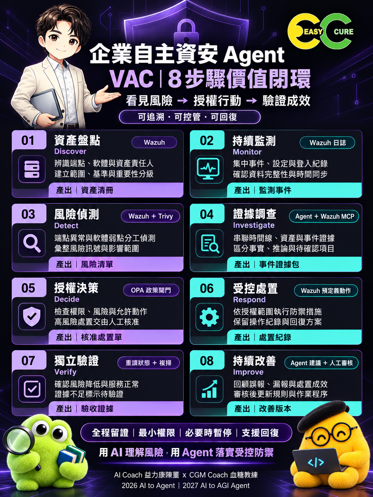

# 圖卡與視覺資產

## 最新 VAC

版式：兩欄四列；深黑、紫色、青綠；粗體無襯線視覺。右上公司 Logo，陳董半身與玩偶點綴，底部完整署名，無頁碼。01–08 是流程步驟。

VAC 在本方法論指視覺任務卡；圖中「8 步驟價值閉環」是流程描述，不是另訂 VAC 英文全名。圖卡為教學概覽，詳細授權與驗收條件以文字文件為準。

## 方法論圖卡

- [01｜封面](cards/01.png)
- [02｜三層架構](cards/02.png)
- [03｜八項安全職責](cards/03.png)
- [04｜VAC 閉環](cards/04.png)
- [05｜自主授權等級](cards/05.png)
- [06｜工具執行](cards/06.png)
- [07｜證據](cards/07.png)
- [08｜導入路線](cards/08.png)
- [09｜遠端工具案例](cards/09.png)
- [10｜從一件任務開始](cards/10.png)

原有十張採橙光智盾風格，保留其頁碼與版本內容；本次新增 VAC 採深黑紫青風格，不將兩批誤列為同一視覺系列。

## 來源與權利範圍

上述 11 張為本次對話產生的品牌教學圖卡，使用使用者提供的公司 Logo、人物與玩偶參考。未把第三方新聞參考圖、剪片 VAC 原圖或獨立品牌原始素材打包。授權狀態見 [NOTICE](../NOTICE.md) 及 [LICENSE](../LICENSE)。生成圖片不代表其 Logo、肖像或商標可以自由再授權；品牌元素須另外取得權利人許可。未附字型檔。
