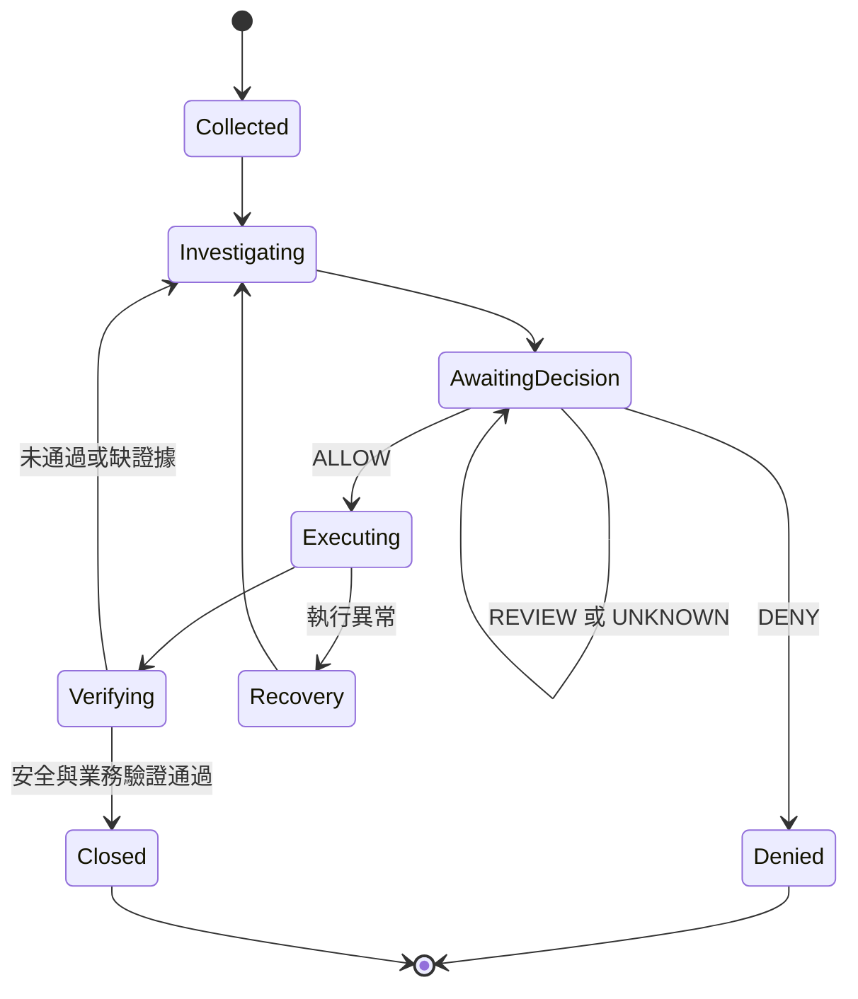

# 03｜VAC 八步視覺任務卡

[查看最新圖卡](../assets/enterprise-security-vac.png) · [工具分工](../docs/tool-catalog.md)

01 資產盤點 → 02 持續監測 → 03 風險偵測 → 04 證據調查 → 05 授權決策 → 06 受控處置 → 07 獨立驗證 → 08 持續改善。

每次事件建立一張 VAC；持續監控服務可不斷建立新卡，不能以一張永不結案的卡混合全部事件。

## 任務必填欄位
event_id、目標、業務背景、資產擁有人、資產／租戶範圍、禁止操作、證據來源與有效時間、工具與版本、政策版本、行動上限、預算、驗收條件、回復程序、授權人／委派鏈、截止時間。

| 步驟 | 輸入與行動 | 輸出 | 通過與失敗處理 |
|---|---|---|---|
| 01 Discover | 清冊對照核准範圍；確認擁有人、關鍵性 | 資產快照與缺口 | 範圍不明則待補，不擴大掃描 |
| 02 Monitor | 收集狀態與事件；檢查時鐘、延遲、來源健康 | 原始證據與收集狀態 | 缺日誌標 UNKNOWN；不可當無威脅 |
| 03 Detect | 規則、指標與行為比對；去重 | 偵測理由、良性替代解釋 | 僅憑軟體名稱不能定罪 |
| 04 Investigate | 關聯程序、帳號、連線與時間線 | 事實／推論／未知、影響範圍 | 證據矛盾則補查；不以自信分數替代佐證 |
| 05 Decide | 比對業務衝擊、政策與可逆性 | 精確行動、決策、回復與驗證計畫 | 輸出 ALLOW／REVIEW／DENY／UNKNOWN |
| 06 Respond | 執行前再查授權與狀態；限定操作 | 前後狀態、回傳碼、執行收據 | 逾時不代表未執行；先查狀態再重試 |
| 07 Verify | 獨立查詢威脅狀態及業務探針 | PASS／FAIL／UNKNOWN／NOT_APPLICABLE | FAIL 回04或05；UNKNOWN保持未結案 |
| 08 Improve | 交付報告、缺口、成本、改善提案 | 事件結案與版本化提案 | 規則／權限變更需測試與覆核後生效 |

## 任務狀態機

拒絕一個行動不等於事件已解決；另選安全方案仍回到調查。每張卡最多兩次自動修正嘗試，超過即人工接管；遇新高風險證據可立即升級，不必耗完次數。
