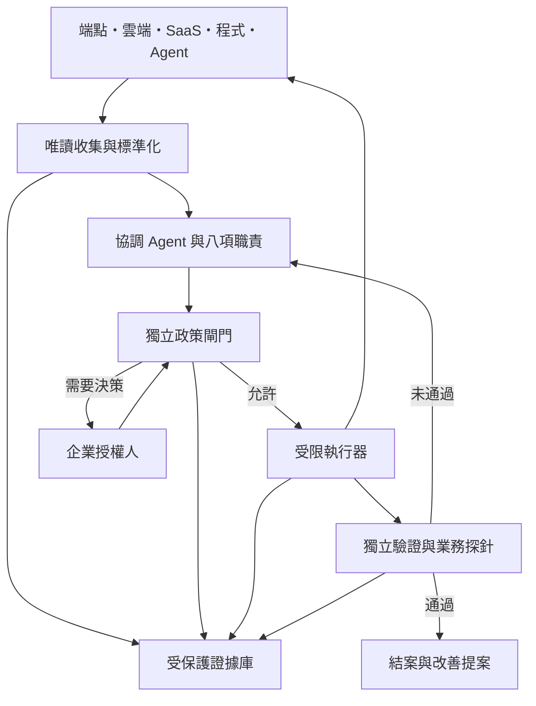

# 02｜VAD 企業自主資安總架構

## 八個職責
| ID | 職責 | 主要輸入 | 主要產出與責任 |
|---|---|---|---|
| R1 | 資產與暴露面 | 清冊、管理平台、核准掃描範圍 | 資產擁有人、關鍵性、外部暴露、監控缺口 |
| R2 | 端點與工作負載 | Defender、主機日誌、服務 | 端點事件、惡意程序線索、限定處置方案 |
| R3 | 網路與雲端 | 網路流量、雲端稽核、設定 | 橫向移動線索、錯誤設定、邊界控制 |
| R4 | 身分與SaaS | 登入、角色、工作階段、OAuth | 身分異常、最小權限、撤銷與回復方案 |
| R5 | 資料與機密 | 分類清冊、存取日誌、機密掃描 | 外洩風險、資料流向、金鑰輪替方案 |
| R6 | 程式與供應鏈 | Repo、依賴、映像、SBOM | 弱點清單、修補提案、供應鏈來源證據 |
| R7 | Agent與工具安全 | 任務、MCP、Skills、記憶、工具呼叫 | 注入與越權阻擋、能力變更審查、委派追蹤 |
| R8 | 復原與持續保證 | 備份、業務探針、事件證據 | 還原測試、獨立驗證、復盤及改善提案 |

八個職責不是八台主機或八個模型。起步採一個協調 Agent；執行器與驗證者使用分離的身分和權限。R8 的結案判定不得由 R2 的執行成功回傳直接代替。

## 資料流與控制邊界

## 信任邊界
| 邊界 | 威脅 | 必要控制 |
|---|---|---|
| 外部事件→Agent | 日誌、檔名、網頁夾帶指令 | 全部視為資料；來源標記；不可修改任務或政策 |
| Agent→政策閘門 | 幻覺、目標偏移、越權提案 | 結構化請求、schema、deny-by-default、規則版本 |
| 閘門→執行器 | 假授權、重放、狀態過時 | 短效能力憑證、行動雜湊、nonce、執行前再檢查 |
| 執行器→企業系統 | 憑證濫用、影響擴散 | 目標與命令 allowlist、限速、單資產試行 |
| 系統→證據庫 | 日誌刪改、個資洩露 | 分權寫入、存取紀錄、加密、保存政策與保全 |
| 改善→正式政策 | 記憶污染、自我放寬權限 | 改善只產生提案；離線驗證、覆核、版本升級 |

## 控制平面保護
協調 Agent 不持有全域管理員憑證，不可修改政策閘門或證據保留規則。身分憑證由獨立保管服務短效發放。執行器不能刪除自己的稽核紀錄。管理者可從獨立通道撤銷能力憑證與停止工作。

## 故障行為
模型、政策閘門或證據服務不可用時，停止新的變更工作並建立待處理事件；原有 Defender、防火牆等既有控制持續運作。寫入失敗的變更不能標記成功。重啟後先核對未完成工作，避免重複執行。

